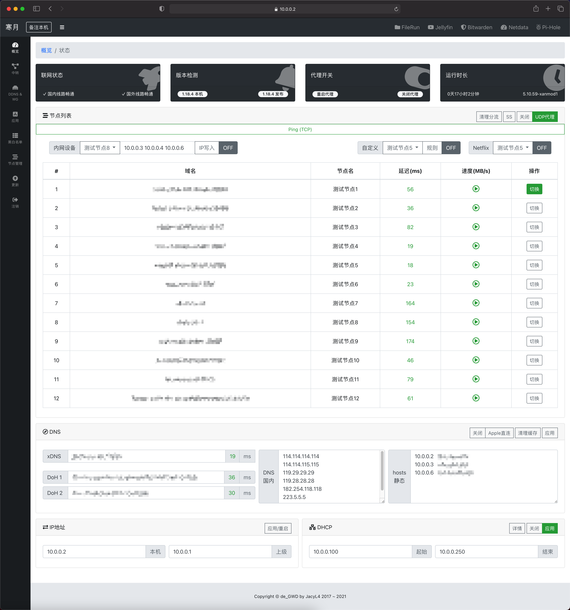
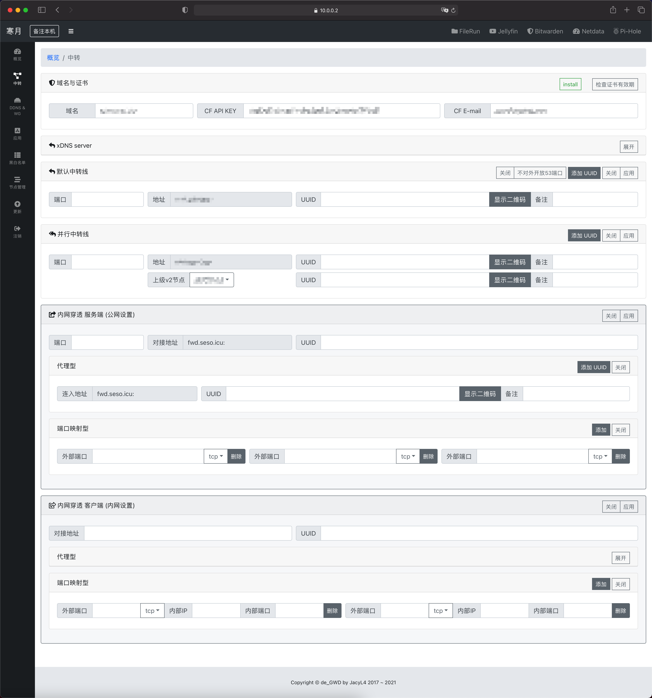
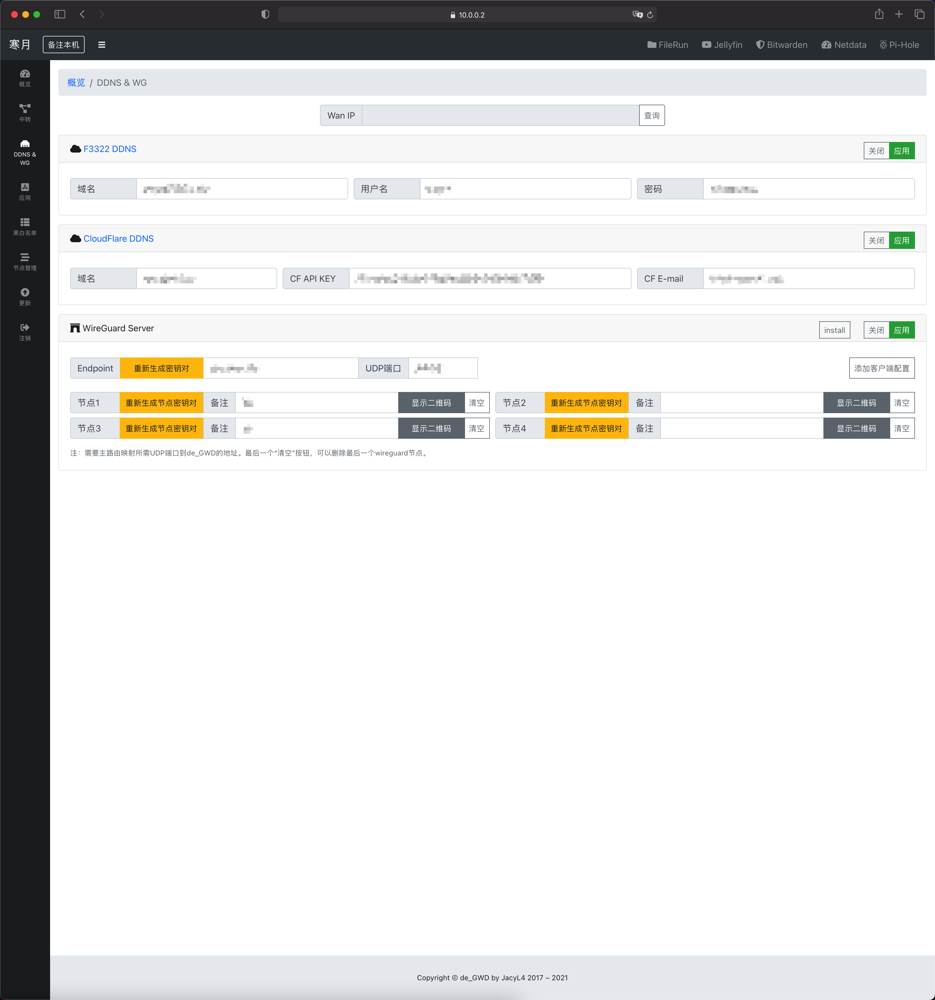
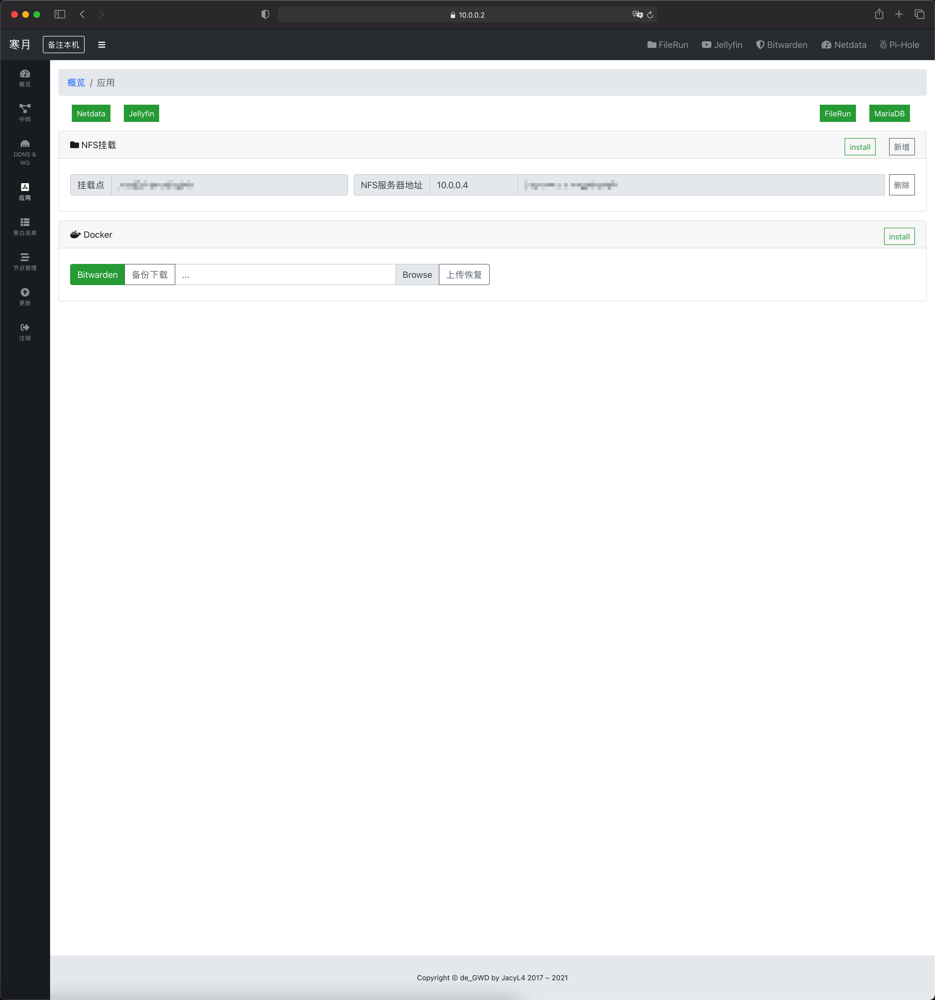
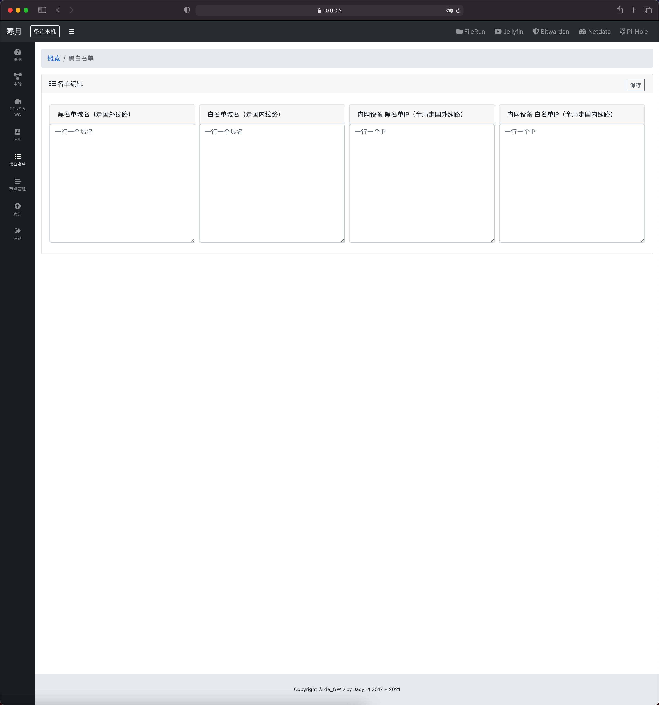
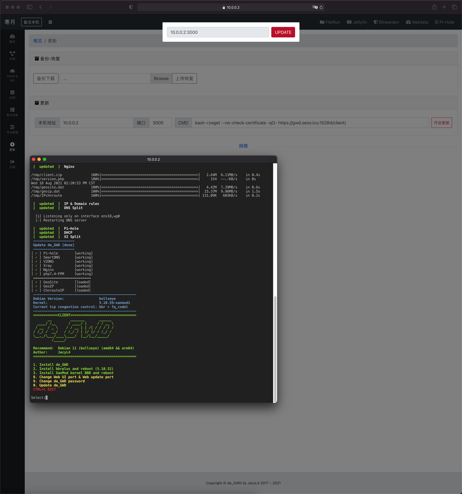

# mygwd

基于 [de_GWD](https://github.com/jacyl4/de_GWD) 的 Debian 13 旁路网关与 DNS 项目，继承 [XDcooler/de_GWD](https://github.com/XDcooler/de_GWD) 的客户端登录、DNS 恢复、国内转发及后台更新修复。

安装和面板更新默认使用本仓库 `XDcooler/mygwd`。为兼容已有配置，系统内的 `/opt/de_GWD` 路径与服务名称保持不变。修复内容和实机验证见 [mygwd 发布说明](docs/mygwd-release.md)，原有 [EPL-2.0 许可证](LICENSE.md) 保留。

遗留的旧仓库资源环境变量会迁移至 mygwd；完整客户端更新也会同步修正配置中的更新入口。迁移范围与固定版本用法见 [更新指南](docs/update-guide.md)。

## 仅供学习与研究

[](https://t.me/de_GWD)
[](https://discord.gg/pgwwzevfNS)


本版要求 Debian 13。客户端管理面板使用发行版 PHP 8.4；两端使用固定官方 Pi-hole 6，标准服务端不依赖 PHP。

客户端新增 26 项服务分流，覆盖流媒体、AI、PlayStation、Xbox、Nintendo、Steam 与 Epic；支持默认/直连/指定节点，游戏主机还可按固定 IPv4 配置。GeoIP、GeoSite、中国路由和广告规则每日 04:00 更新，校验或应用失败保留上次验证配置。
## Debian 13 服务端（amd64 / arm64）
```
apt install -y curl
bash <(curl -fsSL https://raw.githubusercontent.com/XDcooler/mygwd/main/server)
```

服务端也支持明确的 Bash 命令：`bash server --install example.com`、`bash server --update`、
`bash server --kernel-check`、`bash server --update-kernel`、`bash server --enable-bbr`。
内核更新安装匹配的 Debian 内核元包，保留旧内核并提示手动重启；开启 BBR 是独立操作。
服务端 SSH 菜单 2 为启用当前内核 BBR；菜单 3 安装官方 XanMod LTS、配置 BBR 并在启动校验后自动重启（仅 amd64、标准 GRUB），与客户端共用安装器。Debian 官方内核更新继续使用 `--update-kernel`。
下载方式、域名证书要求和验证范围见 [服务端 Bash 安装与内核更新](docs/server-install-kernel.md)。


## Debian 13 客户端（amd64 / arm64）
```
apt install -y curl
bash <(curl -fsSL https://raw.githubusercontent.com/XDcooler/mygwd/main/client)
```

完整步骤见 [客户端部署指南（Debian 13 / 威联通 NAS）](docs/client-deployment.md)，包含虚拟交换器、server 节点获取、固定地址、安装参数、HTTPS、分流、验收与下载故障排查。

客户端 SSH 菜单 2 启用当前内核 BBR；菜单 3 安装官方 XanMod LTS、配置新内核 BBR，并在核对启动配置后自动重启生效（仅 amd64、标准 GRUB）。此操作独立于应用更新，说明见 [两端 XanMod 内核](docs/client-xanmod.md)。

## 更新已安装的客户端和服务端

在对应 Debian 13 机器的 **root Bash** 中执行，只选择本机角色对应的一组。更新会重建配置并重启相关服务，应先保存配置或虚拟机快照。
这里的“最新版本”指本仓库 `main` 中的项目脚本及配套资源；第三方代理核心、Pi-hole 等使用项目指定版本，并非自动追踪各组件的最新发布。

**服务端更新：** 重新下载最新脚本，通过语法检查后更新应用。保持 SSH 会话在线，或先进入 screen/tmux 会话。

```bash
install -d -m0700 /root/mygwd-updates
curl --fail --location --proto '=https' --proto-redir '=https' \
  --connect-timeout 15 --max-time 120 \
  https://raw.githubusercontent.com/XDcooler/mygwd/main/server \
  -o /root/mygwd-updates/server.download &&
bash -n /root/mygwd-updates/server.download &&
mv -f /root/mygwd-updates/server.download /root/mygwd-updates/server &&
bash /root/mygwd-updates/server --update
```

**客户端更新：** 启动独立后台任务并显示日志；关闭 SSH 或按 Ctrl+C 退出日志查看后，后台更新继续。

```bash
install -d -m0700 /root/mygwd-updates
curl --fail --location --proto '=https' --proto-redir '=https' \
  --connect-timeout 15 --max-time 120 \
  https://raw.githubusercontent.com/XDcooler/mygwd/main/client \
  -o /root/mygwd-updates/client.download &&
bash -n /root/mygwd-updates/client.download &&
mv -f /root/mygwd-updates/client.download /root/mygwd-updates/client &&
bash /root/mygwd-updates/client --web-update
```

客户端可用 `cat /var/lib/de-gwd-update/status.json` 查看结果，以 `status: succeeded`、`exit_code: 0` 为成功；后台任务启动成功不等于更新完成。
需要前台执行时，将客户端最后一行改为 `bash /root/mygwd-updates/client --update`，此模式保持 SSH 会话在线。

只刷新 GeoIP、GeoSite、中国路由和广告规则，两端均可运行：

```bash
bash /opt/de_GWD/ui-updateRules
```

系统安全补丁、客户端 PHP 补丁及服务端内核更新使用各自流程，不要用反复更新项目代替。
更新范围、旧版本迁移、固定提交版本、日志、验收与恢复见 [客户端与服务端更新指南](docs/update-guide.md)。









## Manual:
项目结构、已修复问题和验证边界见 [项目分析与修复说明](docs/bugfixes.md)。
开发验证命令见 [回归测试说明](tests/README.md)。
IP 地址库和广告过滤来源、更新命令见 [规则更新说明](docs/rule-updates.md)。
此前 Debian 11 的部署修复和本地真实节点测试历史见 [部署验证记录](docs/bugfixes.md#2026-10-18-debian-11-实际部署修复)。

## Thanks to
* [ v2fly/v2ray-core ](https://github.com/v2fly/v2ray-core)
* [ XTLS/Xray-core ](https://github.com/XTLS/Xray-core)
* [ Loyalsoldier/v2ray-rules-dat ](https://github.com/Loyalsoldier/v2ray-rules-dat)
* [ misakaio/chnroutes2 ](https://github.com/misakaio/chnroutes2)
* [ StevenBlack/hosts ](https://github.com/StevenBlack/hosts)
* [ privacy-protection-tools/anti-AD ](https://github.com/privacy-protection-tools/anti-AD)
* [ pi-hole/pi-hole ](https://github.com/pi-hole/pi-hole)
* [ m13253/dns-over-https ](https://github.com/m13253/dns-over-https)
* [ pymumu/smartdns ](https://github.com/pymumu/smartdns)
* [ UJX6N/bbrplus-5.10 ](https://github.com/UJX6N/bbrplus-5.10)
* [ mzz2017/lkl-haproxy ](https://github.com/mzz2017/lkl-haproxy)
* [ xanmod/linux ](https://github.com/xanmod/linux)
* [ tsl0922/ttyd ](https://github.com/tsl0922/ttyd)
* [ netdata/netdata ](https://github.com/netdata/netdata)
* [ jellyfin/jellyfin ](https://github.com/jellyfin/jellyfin)
* [ dani-garcia/vaultwarden ](https://github.com/dani-garcia/vaultwarden)

## Stargazers over time
[](https://starchart.cc/XDcooler/mygwd)
